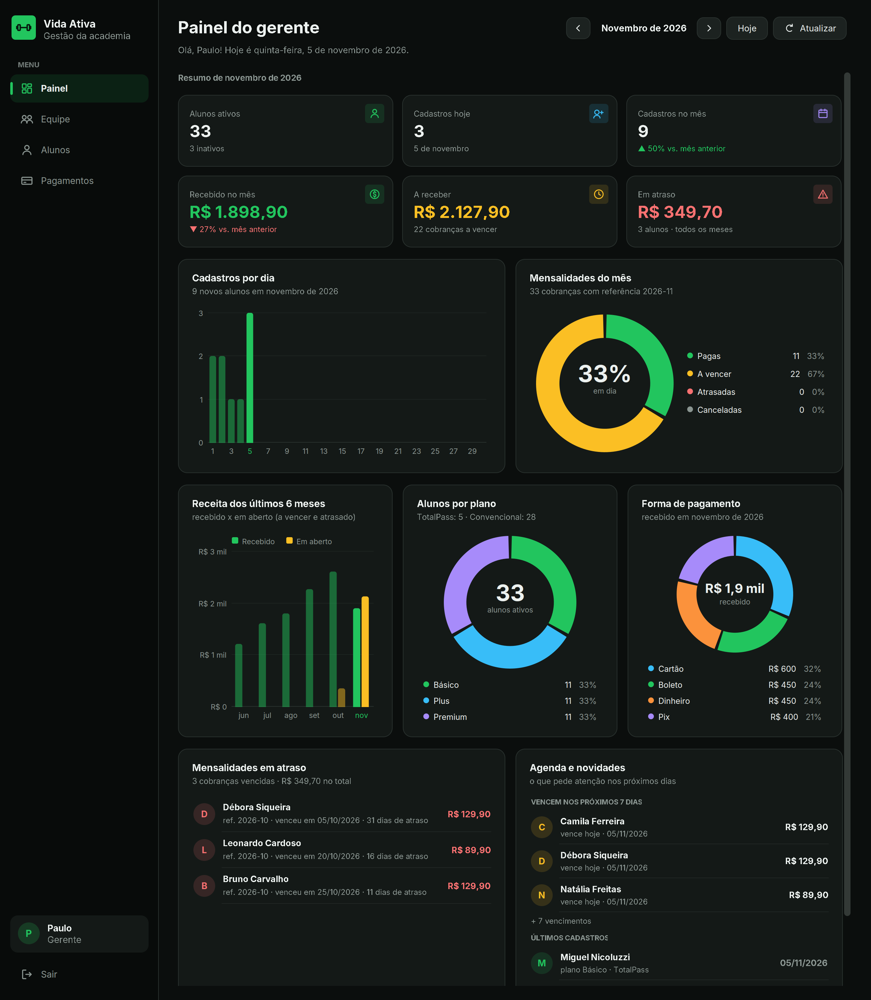
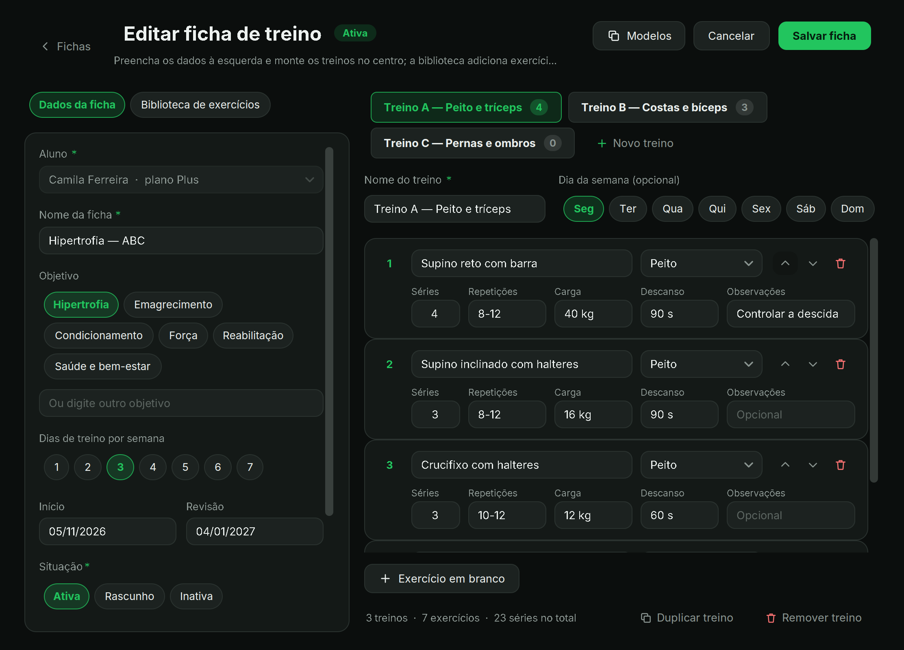
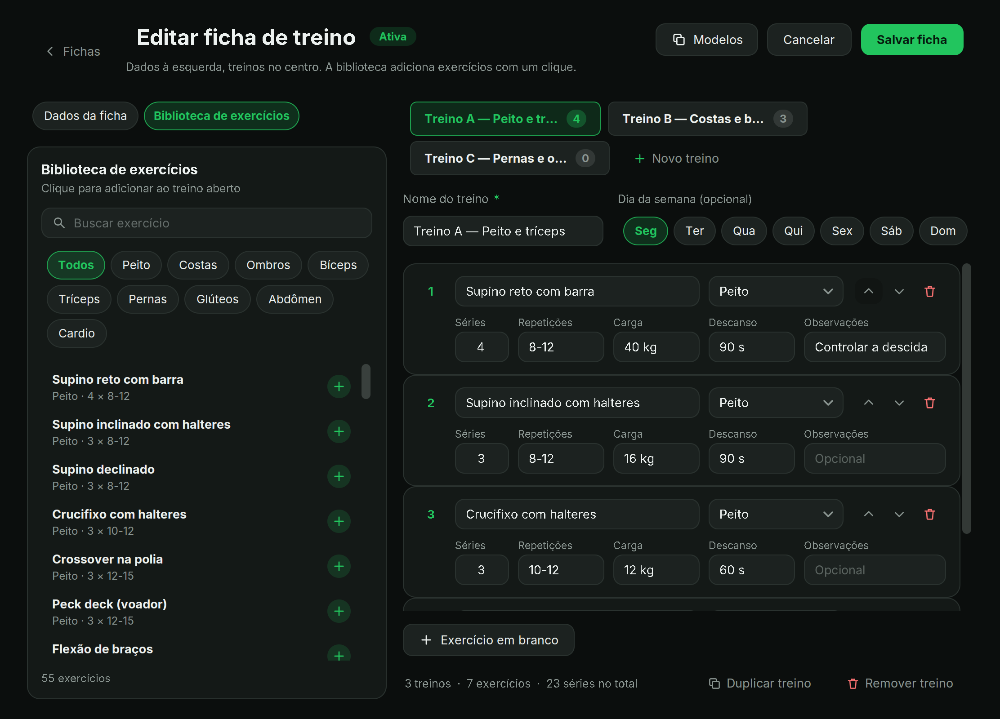

# Design do software

> As imagens em `docs/img/` são capturas com dados de exemplo, geradas sem banco; a fonte do seu Windows (Segoe UI) fica um pouco diferente.

Tema escuro, verde `#22C55E` como cor de ação e cantos arredondados. Tudo é desenhado em Java2D (sem bibliotecas de
visual externas), então o programa continua compilando só com o JDK e o Gson.

## Camadas do visual

| Camada | Onde | O que faz |
|---|---|---|
| Tokens | `ui/Theme.java` | Cores (`GREEN`, `BG`, `PANEL`, `SURFACE`, `BORDER`, `TEXT`, `MUTED`, `DANGER`, `WARN`, `INFO`…), raios, fonte, `Theme.apply()` |
| Estilo dos controles | `ui/estilo/` | Botão arredondado, campo com borda verde no foco, combo, barra de rolagem fina, checkbox |
| Ícones | `ui/Icones.java` | Ícones vetoriais (painel, alunos, pagamentos, lixo, busca…) |
| Componentes | `ui/componentes/` | `Cartao`, `KpiCard`, `Chip`, `Opcoes` (pílulas), `CampoBusca`, `GradeFluida`, `PilhaVertical`, `ConteudoRolavel`, `FluxoLayout` |
| Gráficos | `ui/grafico/` | `GraficoBarras` (várias séries, dica ao passar o mouse) e `GraficoRosca` |

Regras: telas novas usam os componentes acima em vez de montar bordas e cores à mão; cores só vêm do `Theme`.

## Layout que se adapta à janela

O Swing padrão não quebra linhas de componentes. Por isso:
- `GradeFluida`: colunas de mesma largura; o número de colunas depende da largura disponível.
- `PilhaVertical`: empilha blocos dando a largura toda a cada um e perguntando a altura para essa largura.
- `FluxoLayout`: linha que quebra (usada nas pílulas) e avisa o tamanho correto aos pais.
- `ConteudoRolavel`: painel dentro de rolagem que acompanha a largura da janela (só rola na vertical).

## Painel do gerente

Seletor de mês (◀ mês ▶, Hoje, Atualizar), seis indicadores, gráficos e listas:

| Bloco | Mostra |
|---|---|
| Indicadores | Alunos ativos · Cadastros hoje · Cadastros no mês (vs. mês anterior) · Recebido no mês (vs. anterior) · A receber · Em atraso |
| Cadastros por dia | Barras do mês; o dia de hoje fica destacado |
| Mensalidades do mês | Rosca pagas / pendentes / atrasadas / canceladas e % em dia |
| Receita | Últimos 6 meses: recebido × em aberto |
| Alunos por plano e Forma de pagamento | Duas roscas |
| Em atraso e Agenda | Lista de quem está atrasado (dias e valor), cobranças que vencem em 7 dias e últimos cadastros |

Definições dos números (também no Javadoc de `service/Indicadores`):
- **Cadastro**: data de início do aluno. Alunos desativados depois continuam contando.
- **Recebido no mês**: cobranças pagas com data de pagamento no mês (regime de caixa).
- **A receber**: pendentes do mês que ainda não venceram.
- **Em atraso**: todas as atrasadas, de qualquer mês. Pendente com vencimento passado conta como atrasada.
- **% em dia**: pagas ÷ (pagas + pendentes + atrasadas) das cobranças do mês; canceladas ficam de fora.

## Ficha de treino (professor)

`FichasPanel` lista as fichas (busca, filtro por situação, "só as minhas"). Abrir ou criar leva ao `FichaEditor` em tela cheia:
- **Esquerda**: aba *Dados da ficha* (aluno, nome, objetivo, dias por semana, datas, situação, observações) e aba *Biblioteca de exercícios* (busca + grupo muscular; um clique adiciona ao treino aberto).
- **Centro**: abas dos treinos (A, B, C…), dia da semana, e um cartão por exercício (séries, repetições, carga, descanso, observações; subir, descer, remover).
- **Modelos**: botão que preenche a ficha com um modelo pronto (Full body, ABC Hipertrofia, Emagrecimento) pedindo confirmação.
- Regras mantidas: o aluno de uma ficha existente não muda; fichas de outros professores abrem só para consulta; salvar como Ativa desativa as outras do aluno (`FichaTreinoDAO.salvar`).

## Capturas

| Login | Painel do gerente |
|---|---|
|  |  |

| Ficha de treino | Biblioteca de exercícios |
|---|---|
|  |  |
